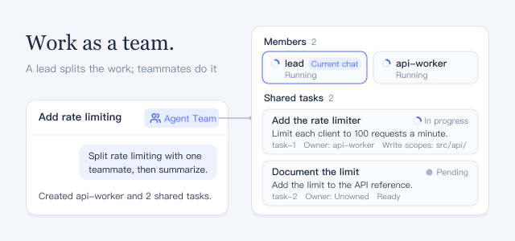

Pide al agente con el que conversas, el líder, que reparta el trabajo. Creará compañeros con nombre, pondrá el trabajo en un tablero de tareas compartido, esperará sus resultados y te los comunicará.

## Cómo usarlo

- Pídelo con tus propias palabras, por ejemplo: «Usa equipos de agentes para repartir esta tarea entre dos compañeros, espera a que terminen y resume los resultados».
- Haz clic en **equipo de agentes**, junto al título de la conversación, para ver **Miembros** y **Tareas compartidas**. Cada tarea muestra su estado, **propietario**, ámbitos de escritura (**Escribir alcances**) y las tareas de las que depende en **Bloqueado por**.
- Haz clic en un compañero para abrir su conversación y hablar con él allí.
- El panel es de solo lectura. Para cambiar tareas o compañeros, pídeselo al líder.

## Ten en cuenta

- Cada compañero es un agente independiente con sus propias solicitudes al modelo, por lo que un equipo consume más tokens que un solo agente.
- Los compañeros comparten los mismos archivos. Si los ámbitos de escritura (**Escribir alcances**) se solapan, solo se muestra una advertencia; nada impide que dos compañeros editen el mismo archivo.
- Un equipo puede crear hasta 8 compañeros en total, incluidos los que no lograron iniciarse, y mantener hasta 256 tareas. Eliminar una tarea libera una plaza.
- Mientras el complemento está activado, las herramientas habituales de subagentes están desactivadas y los agentes delegan a través del equipo. Los flujos de trabajo siguen pudiendo iniciar agentes de una sola ejecución. Desactivar el complemento restaura las herramientas de subagentes.
- Si activas el complemento con una conversación abierta, recarga la página para ver el panel.
